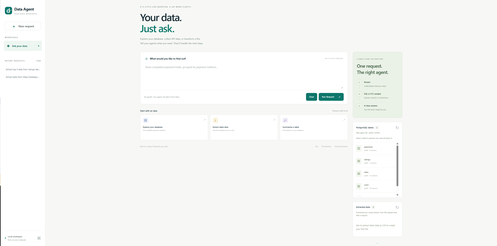
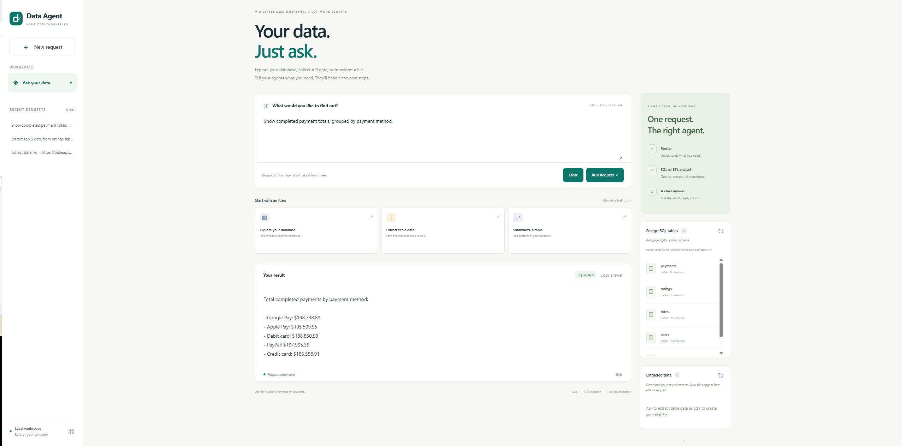
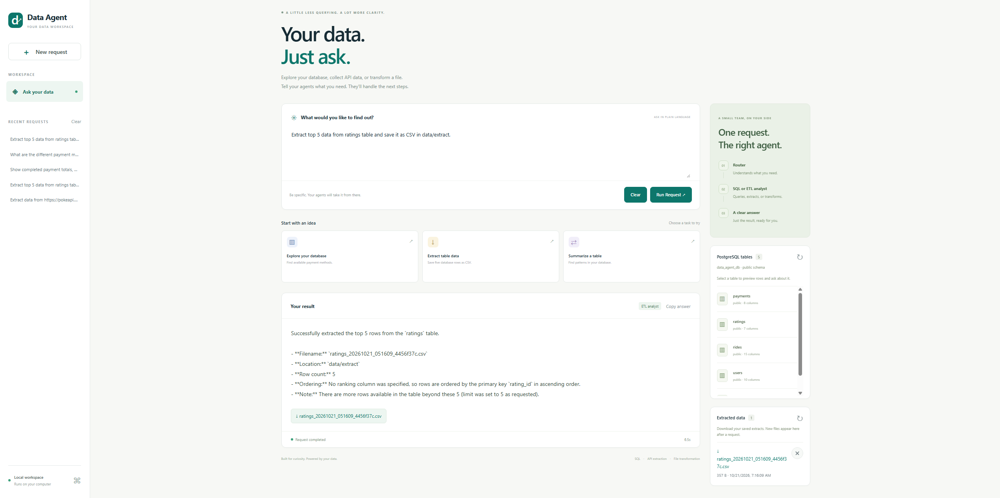
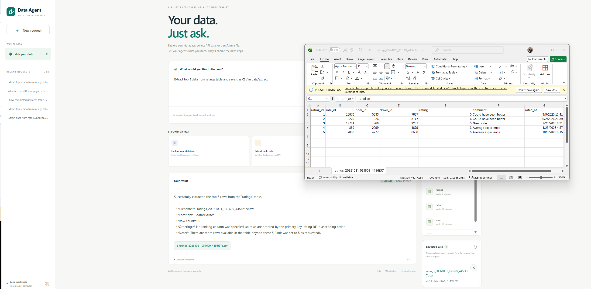
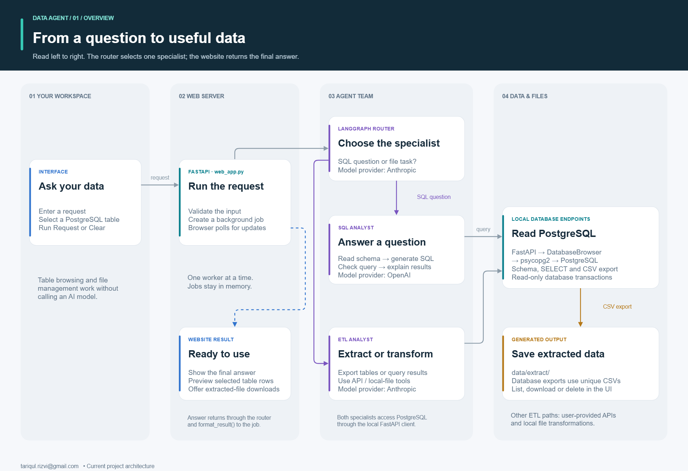
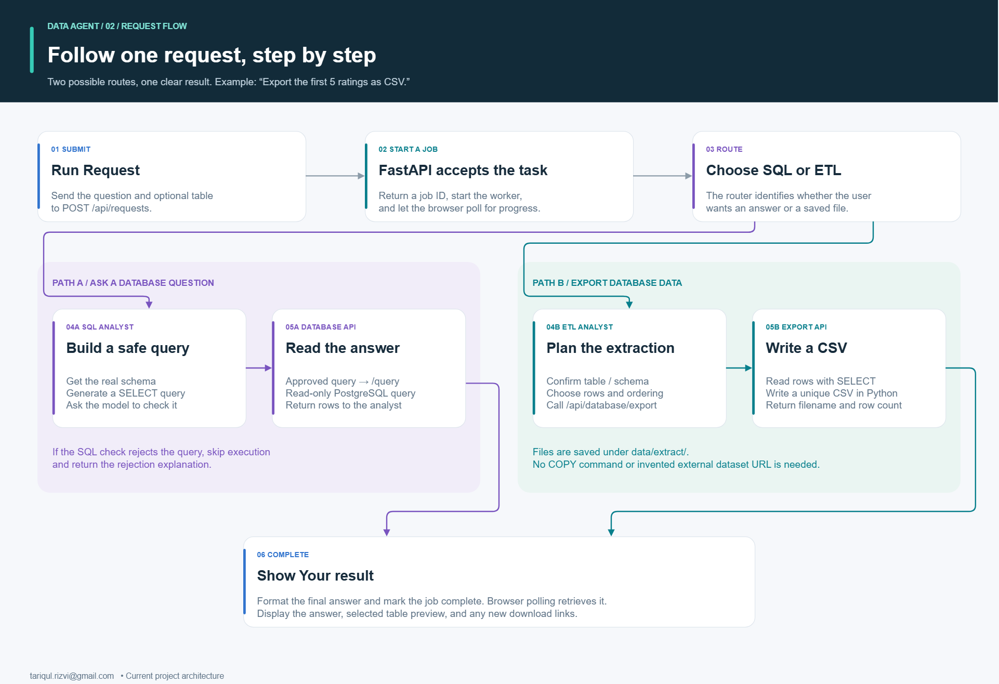

# Agentic AI Data Agent

A local FastAPI website for asking questions about PostgreSQL data and exporting results with natural-language requests. A LangGraph router chooses a SQL analyst for database questions or an ETL analyst for extraction and transformation tasks.

The repository includes sample ride-service datasets: users, vehicles, rides, payments, and ratings. You can also connect the app to your own PostgreSQL database.

## Features

- Browse readable PostgreSQL tables in the `public` schema and preview up to 50 rows.
- Ask questions involving filters, joins, aggregation, and ranking.
- Export database tables or query results as uniquely named CSV files.
- Download files from **Extracted data**. Its cross icon deletes a file immediately, without a confirmation dialog.
- Click **Run Request** to display the final answer and table preview under **Your result**. **Clear** resets the prompt, table selection, and result view.
- Extract data from a user-provided API URL or request local file transformations.

See [WEBSITE.md](WEBSITE.md) for detailed website behavior and configuration.

For business stakeholders and managers, read the
[scenario-based stakeholder guide](docs/STAKEHOLDER_GUIDE.md). It explains practical
use cases, example requests, expected outputs, decisions they support, and how to
evaluate the project in a pilot.

A concise three-page stakeholder brief is available as a
[PDF](output/pdf/stakeholder-brief.pdf), an
[Overleaf-ready ZIP](docs/stakeholder-guide-overleaf.zip) and
[LaTeX source](docs/overleaf/main.tex). In Overleaf, choose
**New Project > Upload Project**, upload the ZIP, and compile `main.tex` with
**pdfLaTeX**. The package includes the diagrams and screenshots.

## Data in the sample database

The five CSV files directly under `data/` describe a ride-service business.
[feed_db.py](feed_db.py) creates matching PostgreSQL tables in the `public` schema
and loads those files. The counts and example values below describe the shared
CSV files, not a live count of your configured database. Your database may change
or contain a different dataset.

### `users`: rider and driver profiles

**Sample size:** 10,000 rows and 10 columns: 7,000 riders and 3,000 drivers.
Each row represents one user profile, identified by the primary key `user_id`.

- **Identity and contact:** `first_name`, `last_name`, `email`, and `phone`.
- **Profile location:** `city` and `province`.
- **Account information:** `user_type` (`rider` or `driver` in the sample),
  `signup_date`, and `is_active`.

Use this table to attach names to ride, payment, and rating records or analyze
account registrations. `is_active` is an account flag, not proof that a driver is
currently available. A user's profile city is not necessarily the location of a ride.

### `vehicles`: vehicles associated with drivers

**Sample size:** 3,000 rows and 8 columns. Each row represents a vehicle record,
identified by `vehicle_id`. Its `driver_id` references `users.user_id`.

- **Vehicle description:** `make`, `model`, `year`, `license_plate`, and `color`.
- **Record status:** `is_active`.

The sample includes Ford, Honda, Hyundai, Nissan, Tesla, and Toyota vehicles with
model years from 2015 to 2026. Use it for vehicle inventory and driver-to-vehicle
lookups. The schema does not restrict a driver to one vehicle, and `rides` has no
`vehicle_id`; joining by driver alone cannot establish which vehicle served a ride.

### `rides`: trip requests and their recorded outcomes

**Sample size:** 20,000 rows and 15 columns. Each row represents a ride record,
identified by `ride_id`. Both `rider_id` and `driver_id` reference `users.user_id`.

- **Timing:** `requested_at`, `pickup_time`, and `dropoff_time`.
- **Locations:** `pickup_latitude`, `pickup_longitude`, `dropoff_latitude`, and
  `dropoff_longitude`.
- **Trip and fare details:** `distance_km`, `fare`, and `surge_multiplier`.
- **Outcome:** `status` and `cancellation_reason`.

Sample statuses are `requested`, `in_progress`, `completed`, and `cancelled`.
Cancellation reasons include `rider_cancelled`, `driver_cancelled`,
`driver_too_far`, `rider_no_show`, and `other`; reasons are blank for non-cancelled
rides in the supplied CSV. Use this table for ride volumes, cancellation analysis,
and pickup or journey timing. It stores a ride record's status, not a history of
every status change.

### `payments`: payment records associated with rides and users

**Sample size:** 16,073 rows and 8 columns. Each row represents a payment record,
identified by `payment_id`. `ride_id` references `rides.ride_id`, and `user_id`
references `users.user_id`.

- **Payment details:** `amount`, `payment_method`, and `payment_status`.
- **Tracking:** `transaction_id` and `payment_time`.

Sample payment methods are `credit_card`, `debit_card`, `paypal`, `apple_pay`, and
`google_pay`. Payment statuses are `completed`, `failed`, and `refunded`.
Use this table to investigate failures or summarize payments by method, status,
or period. A ride's status and its payment status are separate business facts.
The table has no currency field, so confirm a common currency before adding amounts.
A failed payment alone does not establish an outstanding debt.

### `ratings`: feedback about rides and drivers

**Sample size:** 12,000 rows and 7 columns. Each row represents a rating record,
identified by `rating_id`. `ride_id` references `rides.ride_id`; `rider_id` and
`driver_id` reference `users.user_id`.

- **Feedback:** `rating` (a score from 1 to 5 when present) and `comment`.
- **Timing:** `rated_at`.

Use this table for driver rating averages, review counts, and feedback analysis.
Include the number of ratings when comparing averages, and do not assume every
ride has feedback. A comment records feedback; it does not establish its cause.

### Relationships and reporting periods

A user can appear in many ride, payment, or rating records. A ride can be linked
to payments and ratings through `ride_id`. The schema does not enforce one payment
or one rating per ride: aggregate those records separately before combining them
when calculating totals, to avoid counting the same payment multiple times.
User roles should also be checked when interpreting references as riders or drivers;
the foreign keys only require a matching user ID.

The shared CSVs contain signup dates from **2023-01-01 to 2026-07-30** and ride
request, payment, and rating dates from **2025-01-01 to 2026-07-30**. Choose a
reporting period within the actual connected data. The seed schema's timestamps
do not specify a timezone, so agree on the reporting timezone before using daily
or hourly boundaries.

## Website walkthrough

### 1. Start in the data workspace

Enter a question in the main prompt, choose an example, or select a table from
**PostgreSQL tables** on the right. **Run Request** submits the task; **Clear**
resets the prompt and result view. Recent requests appear in the left sidebar.



*The workspace brings natural-language requests, live database tables, and extracted files together.*

### 2. Ask a database question

For example: "Show completed payment totals, grouped by payment method."
The router selects the SQL analyst, and the answer appears under **Your result**.
Use **Copy answer** to copy it. Totals shown in a demonstration reflect that
database's records at the time of the request.



*A database question returns a readable answer under Your result, with the SQL analyst identified.*

### 3. Extract database rows as CSV

Ask: "Extract the first 5 rows from ratings, ordered by rating_id ascending, and
save them as CSV in data/extract."
The ETL analyst creates an extract and returns its filename, row count, and ordering.
Download it from the result link or the **Extracted data** panel. The cross icon
deletes that extracted file immediately.



*The extraction result reports the saved file and row count; the same CSV appears in Extracted data.*

### 4. Open the downloaded file in a spreadsheet

Open the CSV in Excel or another spreadsheet application to inspect the exported
rows. A five-row ratings extract includes the table's columns, such as rating ID,
ride ID, rider ID, driver ID, rating, comment, and rating timestamp.
The downloaded file is a snapshot; it does not update when the database changes.



*The downloaded CSV opens in Excel for inspection and further analysis.*

## Architecture

The application has four main parts: the browser workspace, a FastAPI server,
a LangGraph agent team, and database/file access. FastAPI serves the website and
runs the agents locally. The agents call external AI providers to interpret requests,
generate queries, and explain results.

### System overview



Read the diagram from left to right. The purple branches represent the two
specialists the router can choose. The dashed blue line shows the website receiving
the completed job's result.

1. **Your workspace** — [static/index.html](static/index.html) and
   [static/app.js](static/app.js) provide the prompt, table selection, result view,
   and file controls. The browser sends requests to FastAPI and polls for progress.
   Recent completed answers are stored in the browser.
2. **Web server** — [web_app.py](web_app.py) validates requests, assigns job IDs,
   and runs one agent task at a time in a background worker. This lets the server
   continue responding to polling and database API calls while an agent works.
   Job records are held in memory and are cleared when the server restarts.
3. **Agent team** — [agents/data_agent.py](agents/data_agent.py) routes each request
   to one specialist. The [SQL analyst](agents/sql_analyst.py) handles questions,
   joins, filtering, and summaries. The [ETL analyst](agents/etl_analyst.py) handles
   requests to extract, export, or transform data, including database-to-CSV exports.
   The router and ETL analyst use Anthropic; the SQL analyst uses OpenAI. Model
   selection is configured in [utils/llm_pick.py](utils/llm_pick.py).
4. **Data and files** — Both specialists access PostgreSQL through
   [utils/database_api.py](utils/database_api.py), which calls the local FastAPI
   database endpoints. The ETL agent exposes those calls as tools in
   [utils/database_tools.py](utils/database_tools.py). On the server,
   [DatabaseBrowser](utils/database_browser.py) uses `psycopg2` to read PostgreSQL
   with read-only transactions, timeouts, and row limits.

Database exports retrieve rows with SELECT, then
[utils/extracted_files.py](utils/extracted_files.py) writes a uniquely named CSV
under `data/extract/`. The website uses separate endpoints to list, download, and
delete these files. Shared sample CSVs directly under `data/` remain repository
inputs and are not served by the file panel.

Table browsing and file management call FastAPI directly and do not invoke an AI
model. pgAdmin is an optional administration client; the application connects to
PostgreSQL itself. External API extraction and local file transformation are
additional ETL tool paths, separate from the database endpoints.

### How a database request runs



1. **Submit the request.** Clicking **Run Request** sends the question and optional
   selected table to `POST /api/requests`. For example: "Export the first 5 rows
   from ratings, ordered by rating_id, as CSV."
2. **Start a job.** FastAPI validates the input, creates a job ID, and starts the
   background worker. The browser polls `GET /api/requests/{id}` until it finishes.
3. **Choose the route.** The router selects SQL for a database answer or ETL when
   a file is requested. The example above follows the ETL branch.
4. **Run the specialist.** The two branches use different workflows:

   - **SQL question:** retrieve the real schema, generate a SELECT query, and ask
     the model to check it. An approved query runs through `/api/database/query`;
     the SQL analyst then explains the returned rows. A rejected query is skipped
     and the rejection explanation is returned.
   - **CSV export:** confirm the table or schema, select the requested rows and
     ordering, and call `/api/database/export`. FastAPI reads PostgreSQL and writes
     the CSV in Python, returning the filename and row count. For the example,
     the request specifies `table=ratings`, `limit=5`, and `order_by=rating_id`.

5. **Return the result.** The specialist's response returns through the router.
   [format_result()](utils/output.py) extracts the final answer for the completed
   job. The browser displays it under **Your result**, alongside a selected-table
   preview and any new file links. The preview shows the selected table's rows;
   it is separate from the agent's query result or exported CSV.
6. **Use the output.** Download the CSV from **Extracted data**, or click its cross
   icon to delete that extracted file immediately. **Clear** resets the prompt,
   table selection, and result view.

### Diagram files

Open [architecture.drawio](docs/architecture.drawio) in draw.io / diagrams.net
using **File > Open From > Device**. Switch between **System architecture** and
**Database request steps** using the page tabs. All boxes, labels, and connectors
are editable.

Full-size previews: [architecture PNG](docs/architecture-overview.png) and
[request flow PNG](docs/architecture-request-flow.png).

## Requirements

- Python 3.12 or newer
- `uv`, or Python's `venv` and `pip`
- A running PostgreSQL server and database credentials
- Anthropic and OpenAI API keys for the complete agent workflow

The router and ETL agent use Anthropic; the SQL agent uses OpenAI. Browsing database tables does not call an AI model. Agent requests can incur API charges.

## Setup on Windows

### 1. Install dependencies

From PowerShell:

```powershell
git clone https://github.com/Rizvi-07/agentic-ai-data-agent.git
cd agentic-ai-data-agent
uv sync
```

If you already have the project, open its folder and run `uv sync`. Alternatively, install with pip:

```powershell
python -m venv .venv
.\.venv\Scripts\python.exe -m pip install -r requirements.txt
```

### 2. Configure the environment

Create a `.env` file in the project root:

```dotenv
ANTHROPIC_API_KEY=your-anthropic-api-key
OPENAI_API_KEY=your-openai-api-key

host=localhost
port=5432
user=your-postgresql-user
password=your-postgresql-password
database=data_agent_db

# Optional: CLI agents use this local FastAPI server address.
DATA_AGENT_API_URL=http://127.0.0.1:8000
```

Match these values to your PostgreSQL installation. Database setting names are lowercase. Keep real credentials in `.env`, which is ignored by Git.

Model selection is defined in [utils/llm_pick.py](utils/llm_pick.py). Set its model identifiers to models available to your provider accounts, with tool calling for the ETL agent. The current code does not read `LLM_MODEL_LOW`, `LLM_MODEL_MEDIUM`, `LLM_MODEL_HIGH`, or `AGENT_MODE` environment settings.

The app connects to **PostgreSQL**. pgAdmin is an optional administration client and does not need to be open while the website runs.

### 3. Prepare the database

For an existing database, configure the connection above and give the application user permission to read the relevant tables in `public`.

To try the supplied datasets, first create a dedicated PostgreSQL database, such as `data_agent_db`, using pgAdmin or `psql`, and point `.env` at it.

**The seed script clears the existing `users`, `vehicles`, `rides`, `payments`, and `ratings` tables with `TRUNCATE ... CASCADE` before reloading them. Use a disposable demo database; dependent tables can also be cleared.** The seed user needs table creation and write privileges.

Run from the project root:

```powershell
.\.venv\Scripts\python.exe feed_db.py
```

This creates the five tables and loads the shared CSV files directly under `data/`. You can then use a separate database user with read access for the website.

### 4. Start the website

```powershell
.\.venv\Scripts\python.exe -m uvicorn web_app:app --host 127.0.0.1 --port 8000
```

Or run `./run_website.ps1` after installing dependencies.

- Website: <http://127.0.0.1:8000>
- Interactive API documentation: <http://127.0.0.1:8000/docs>

Keep the terminal open. Press Ctrl+C to stop the server, and restart it after changing `.env` or Python code. Use a single Uvicorn worker.

## Example requests

- "Which riders have failed payments? Show their names, payment amounts, and ride IDs."
- "Show total payment amounts grouped by payment status and payment method."
- "Extract the first 5 rows from ratings, ordered by rating_id, and save them as CSV in data/extract."
- "Export the 10 drivers with the highest average rating and at least 5 ratings. Include their names, average rating, and rating count."
- "Export failed payments with rider names and ride dates, ordered by payment_time descending, as CSV in data/extract."
- "Extract data from https://pokeapi.co/api/v2/pokemon and save it as CSV in data/extract."

Named database tables are accessed through the local FastAPI endpoints. The agent checks the real database schema rather than searching for an external dataset URL. Exports retrieve rows with SELECT and write CSV in Python; they do not use SQL COPY.

Specify an ordering when asking for "top" records. Without an explicit ranking, table exports use the primary key, or the first column if no primary key exists. Database query/export tools default to 1,000 rows and accept at most 10,000 rows. The original external API extraction tool expects JSON containing a `results` array.

## API reference

The main API endpoints are:

- `POST /api/requests` and `GET /api/requests/{id}`: submit and track an agent request.
- `GET /api/database/tables`: list readable PostgreSQL tables.
- `GET /api/database/preview?table=ratings`: preview a table.
- `GET /api/database/schema`: retrieve columns, keys, and sample values.
- `POST /api/database/query`: execute a bounded read-only SELECT query.
- `POST /api/database/export`: export a table or SELECT query to CSV.
- `GET /api/extractions`: list up to 100 recent CSV, JSON, or Parquet extracts.
- `GET /api/extractions/download?path=<filename>`: download an extracted file.
- `DELETE /api/extractions?path=<filename>`: delete one extracted file.

Use the local `/docs` page to inspect request bodies and try endpoints.

## Command-line agents

Keep the FastAPI server running when using database tools from the CLI. In a second terminal, from the project root:

```powershell
.\.venv\Scripts\python.exe main.py
```

`main.py` contains a sample Pokemon API extraction request. Change the `HumanMessage` text to try another request. Its output uses `format_result()` to print the final answer. For a server on another port, update `DATA_AGENT_API_URL` in `.env`; it must point to a local HTTP server. Website requests automatically use the website server's port.

## Project layout

```text
agents/                  LangGraph router, SQL analyst, and ETL analyst
Models/                  Agent state and response schemas
utils/                   Database API client, tools, file handling, and formatting
static/                  Website HTML, CSS, and JavaScript (no frontend build)
tests/                   Offline website, database, and agent integration tests
docs/                    Editable architecture diagrams and PNG/SVG previews
data/*.csv               Shared sample datasets committed to Git
data/extract/            Generated extracts; ignored except for .gitkeep
data/transform/          Generated transformations; ignored except for .gitkeep
web_app.py               FastAPI website and endpoints
main.py                  Command-line example
feed_db.py               Destructive demo database reload script
run_website.ps1          Windows website launcher
WEBSITE.md               Detailed website guide
pyproject.toml / uv.lock  uv dependency configuration and lockfile
requirements.txt         Pinned dependencies for pip
```

## Checks

```powershell
.\.venv\Scripts\python.exe -m unittest discover -s tests -v
```

Tests use stub models and database responses. They do not call live AI providers or modify your PostgreSQL database.

## Scope and repository hygiene

This app is intended for local use by a trusted user. It has no authentication. The transformation tool executes generated Python without a sandbox. SQL operations use model-based checks and read-only database transactions. Public deployment would require authentication, execution isolation, and additional database controls.

The `.gitignore` excludes credentials, virtual environments, caches, generated extracts and transformations, graph images, and local backup files. Shared sample CSVs under `data/`, source code, tests, documentation, and dependency lockfiles stay eligible for commits. Source datasets are not listed or served by the website.

Ignore rules do not remove files that Git already tracks. Before pushing, review `git status --short` and `git diff --cached`; use `git rm --cached -- <path>` for an already tracked local artifact you want to keep on disk but remove from Git.

## Author and support

Author: **tariqul.rizvi**

For questions or suggestions, open an issue in this repository or contact [tariqul.rizvi@gmail.com](mailto:tariqul.rizvi@gmail.com).
